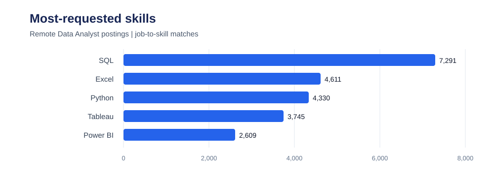
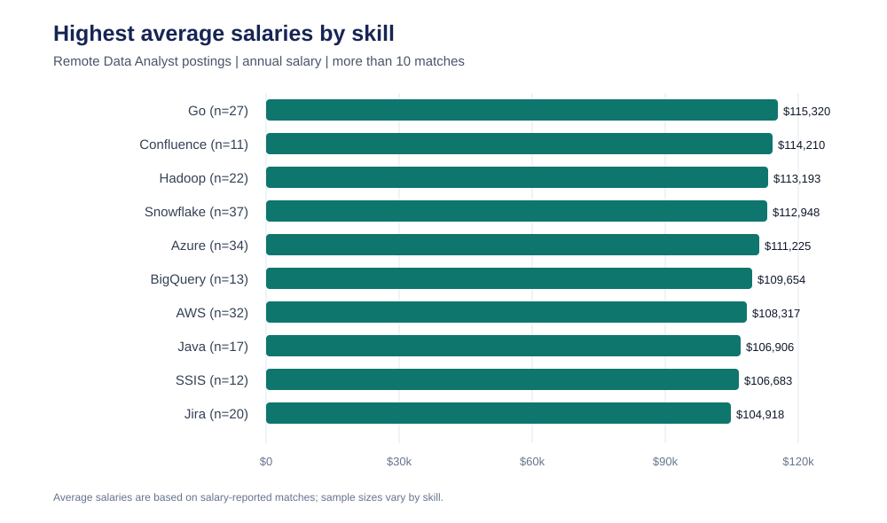
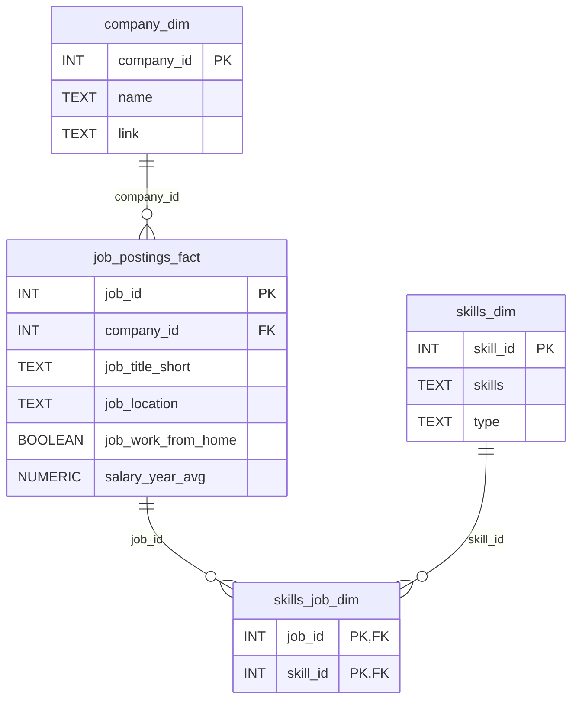

# Data Analyst Job Market Analysis

A PostgreSQL project for exploring data analyst job postings, salary information, and the skills employers request. The SQL queries join job postings to company and skill data to answer questions about high-paying roles, in-demand skills, and skills that combine demand with strong average pay.

## What this project explores

- Which data analyst jobs have the highest reported annual salaries?
- Which skills appear most often in remote data analyst postings?
- Which skills have the highest average annual salaries?
- Which skills are worth considering based on both demand and pay?

## Visual highlights

The charts below were calculated from the CSV files in this repository. They are static SVG images and display the included data snapshot; rerun the SQL against your loaded database if you want to refresh the results after changing the data.

### Most-requested skills in remote data analyst postings

Counts are job-to-skill matches for remote data analyst postings. A posting can require multiple skills, so the counts do not add up to the number of postings.



### Highest average salaries among skills with more than 10 matches

Average annual salary is calculated from remote data analyst job-to-skill matches with a reported annual salary. The chart shows the 10 highest averages among skill IDs with more than 10 matches, ordered by average salary.



## Repository structure

```text
.
|-- csv_files/
|   |-- company_dim.csv
|   |-- job_postings_fact.csv
|   |-- skills_dim.csv
|   `-- skills_job_dim.csv
|-- project_sql/
|   |-- 1_top_paying_jobs.sql
|   |-- 2_top_paying_job_skills.sql
|   |-- 3_top_in-demand_skills.sql
|   |-- 4_top_paying_skills.sql
|   `-- 5_optimal_skills.sql
|-- sql_load/
|   |-- 1_create_database.sql
|   |-- 2_create_tables.sql
|   `-- 3_modify_tables.sql
`-- assets/
    |-- top_skills_demand.svg
    `-- top_skills_salary.svg
```

## Database schema

The project uses four tables. `job_postings_fact` stores job details; the two dimension tables hold company and skill descriptions; and `skills_job_dim` connects postings to their requested skills.



`skills_job_dim` has a composite primary key (`job_id`, `skill_id`), so one job can be associated with many skills and one skill can be associated with many jobs.

## SQL analyses

Run the scripts in `project_sql/` after loading the tables:

| Script | Analysis |
| --- | --- |
| [`1_top_paying_jobs.sql`](project_sql/1_top_paying_jobs.sql) | Lists the 10 highest-paying data analyst postings marked as `Anywhere`, excluding postings without an annual salary. |
| [`2_top_paying_job_skills.sql`](project_sql/2_top_paying_job_skills.sql) | Finds the skills attached to those 10 postings so you can compare requirements for high-paying roles. |
| [`3_top_in-demand_skills.sql`](project_sql/3_top_in-demand_skills.sql) | Ranks the five most-requested skills in remote data analyst postings. |
| [`4_top_paying_skills.sql`](project_sql/4_top_paying_skills.sql) | Ranks skills by average reported annual salary in remote data analyst postings. |
| [`5_optimal_skills.sql`](project_sql/5_optimal_skills.sql) | Combines remote-job skill demand and average salary, requires more than 10 salary-reported job-to-skill matches, and returns the highest-average-salary results. It includes a CTE version and a shorter equivalent query. |

### How to interpret the results

- In these scripts, a remote posting is selected with `job_work_from_home = 'true'`.
- Salary comparisons use `salary_year_avg`; postings without that value are excluded where salary is analyzed.
- Demand is counted from `skills_job_dim` rows. It represents job-to-skill matches, not unique job postings across all skills.
- The demand analysis in script 3 does not require a salary, while the combined salary-and-demand analysis in script 5 does.
- Script 1 looks for the literal location value `Anywhere`; this is separate from the work-from-home filter used by the skill analyses.
- A skill with a high average salary but few matching postings may be less reliable as a general market signal. Script 5's minimum demand threshold helps reduce this effect.

## Getting started

### Requirements

- PostgreSQL
- A PostgreSQL client such as `psql` or pgAdmin
- The CSV files in `csv_files/`

### Create the database and tables

From PowerShell at the repository root, create the database and tables:

```powershell
psql -U postgres -d postgres -f .\sql_load\1_create_database.sql
psql -U postgres -d sql_course -f .\sql_load\2_create_tables.sql
```

The database-creation script creates a database named `sql_course`. If it already exists, create or select another database and connect to it before running the table-creation script.

### Load the CSV data

`sql_load/3_modify_tables.sql` contains `COPY` statements with an absolute path for this workspace. Update those paths to the location of your `csv_files` directory before running the script. PostgreSQL's server process must be able to read files used with `COPY`; a permission error is commonly resolved by using the client-side `\copy` command in `psql` instead.

For example, from a `psql` session connected to `sql_course`, run the following commands after replacing the path with your local CSV directory:

```text
\copy public.company_dim FROM 'D:/sql_project_data_analysis/csv_files/company_dim.csv' WITH (FORMAT csv, HEADER true, DELIMITER ',', ENCODING 'UTF8');
\copy public.skills_dim FROM 'D:/sql_project_data_analysis/csv_files/skills_dim.csv' WITH (FORMAT csv, HEADER true, DELIMITER ',', ENCODING 'UTF8');
\copy public.job_postings_fact FROM 'D:/sql_project_data_analysis/csv_files/job_postings_fact.csv' WITH (FORMAT csv, HEADER true, DELIMITER ',', ENCODING 'UTF8');
\copy public.skills_job_dim FROM 'D:/sql_project_data_analysis/csv_files/skills_job_dim.csv' WITH (FORMAT csv, HEADER true, DELIMITER ',', ENCODING 'UTF8');
```

Load the tables in this order to satisfy the foreign keys: `company_dim`, `skills_dim`, `job_postings_fact`, then `skills_job_dim`.

### Run the analyses

Open a script from `project_sql/` in pgAdmin's Query Tool or run it with `psql`. For example:

```powershell
psql -U postgres -d sql_course -f .\project_sql\3_top_in-demand_skills.sql
```

## Data snapshot

The included `job_postings_fact.csv` contains 787,686 postings. In this snapshot, 13,331 postings are classified as remote data analyst jobs, and 604 of those have a reported annual salary. Counts and chart values depend on this particular snapshot and can change when the source data changes.
